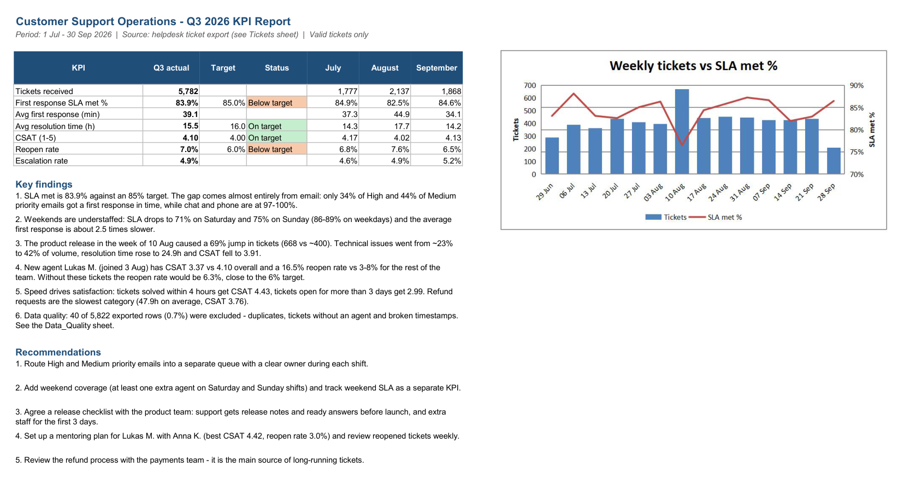
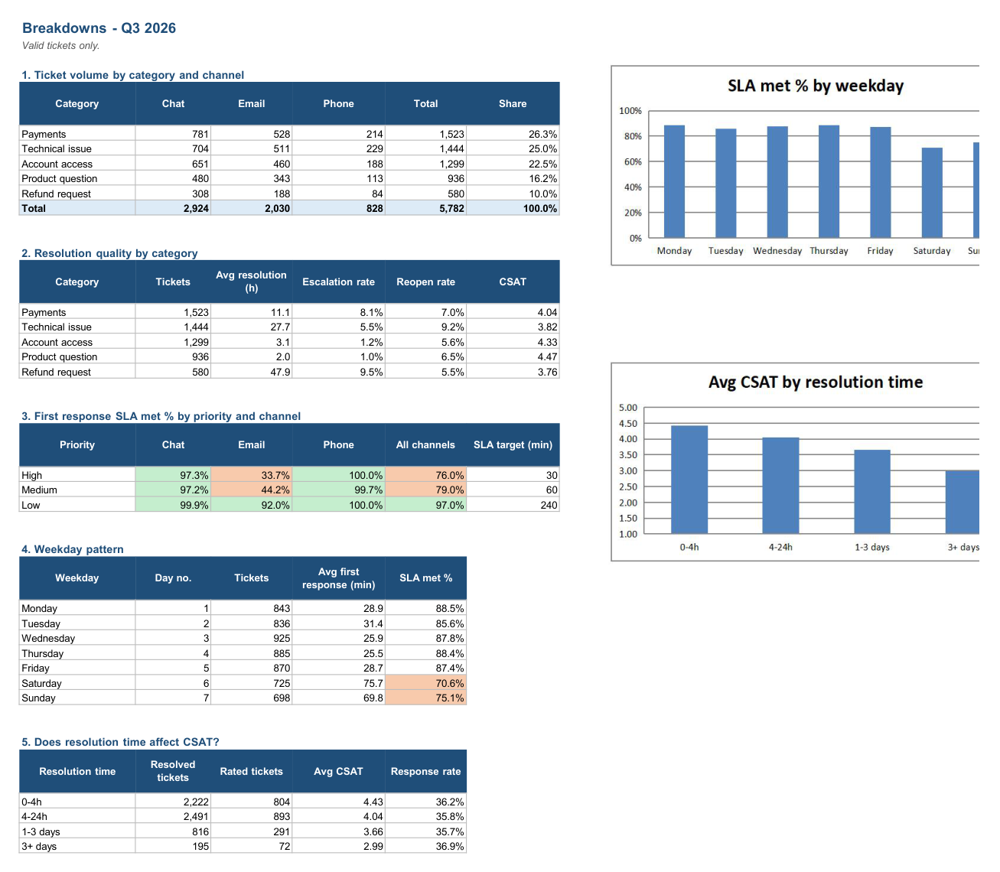
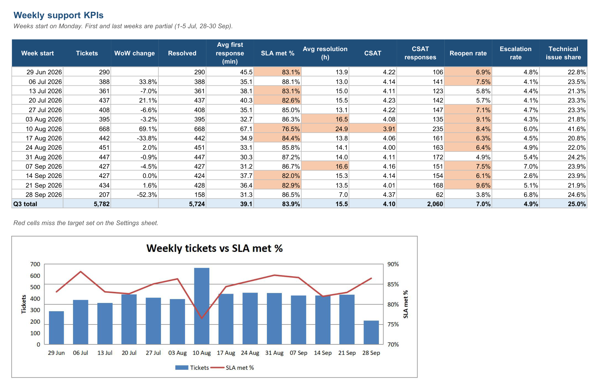
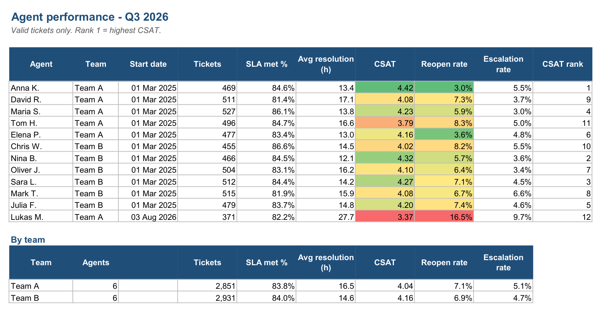

# Customer Support Operations: Q3 2026 KPI Report (Excel)

A quarterly operational report for a customer support team. It covers 5,822 helpdesk tickets (July–September 2026), checks the export for data problems, tracks SLA, resolution time, CSAT and reopen rate by week, agent, category and channel, and ends with findings and recommendations for the support manager.

**Main file:** [`support_kpi_report_q3_2026.xlsx`](support_kpi_report_q3_2026.xlsx)

**Tools:** Excel (COUNTIFS, AVERAGEIFS, SUMPRODUCT, INDEX/MATCH, RANK, conditional formatting, combo charts), Python (pandas, openpyxl)



## What is in the workbook

| Sheet | Contents |
|---|---|
| **Summary** | Q3 KPIs vs targets with monthly split, key findings and recommendations |
| **Weekly_KPIs** | 14 weeks of KPIs with week-over-week change. Cells that miss a target turn red |
| **Agent_Performance** | 12 agents and 2 teams: volume, SLA, resolution time, CSAT, reopen and escalation rate, CSAT ranking |
| **Breakdowns** | category × channel volume, SLA by priority × channel, weekday pattern, resolution time vs CSAT |
| **Data_Quality** | checks on the raw export and how many rows were excluded |
| **Tickets** | raw helpdesk export plus 13 helper columns (formulas) used by all reports |
| **Agents** | agent → team lookup table |
| **Settings** | SLA targets per priority and KPI targets. Changing them updates every sheet |

All numbers in the report are live formulas based on the Tickets sheet. Nothing is pasted as a value, so new data or a changed target updates the whole report.

### How the calculations work

The **Tickets** sheet keeps the raw export (columns A–L) unchanged and adds helper columns:

- `week_start` = `M2-WEEKDAY(M2,3)`, the Monday of the ticket's week
- `first_response_min` and `resolution_hrs`, calculated from timestamps
- `sla_target_min` = `INDEX/MATCH` on the Settings sheet by priority, and `sla_met` = 1/0
- `is_duplicate` = running `COUNTIF($A$2:A2, A2) > 1`, so the first occurrence is kept
- `csat_clean`, which keeps only scores from 1 to 5
- `team` = `INDEX/MATCH` from the Agents sheet
- `is_valid` = not a duplicate, has an agent, and was not resolved before it was created

Every KPI formula filters on `is_valid = 1`. For example, weekly SLA:

```
=AVERAGEIFS(Tickets!$T$2:$T$5823, Tickets!$N$2:$N$5823, $A5, Tickets!$Y$2:$Y$5823, 1)
```

## Data quality

| Check | Rows | Handling |
|---|---|---|
| Duplicate ticket IDs | 14 | excluded |
| Ticket without agent | 17 | excluded |
| Resolved before created | 9 | excluded |
| CSAT outside 1–5 (old 1–10 survey form) | 6 | ticket kept, score ignored |
| **Total excluded** | **40 (0.7%)** | |

## Key findings

**1. SLA is below target because of email, not the whole team.**
Overall first response SLA is 83.9% (target 85%). Chat and phone are at 97–100%, but only 34% of High and 44% of Medium priority emails got a first response in time.



**2. Weekends are understaffed.** SLA drops to 71% on Saturday and 75% on Sunday, compared with 86–89% on weekdays. First response is about 2.5 times slower.

**3. A product release caused the worst week of the quarter.** In the week of 10 August tickets jumped by 69% (668 vs about 400). Technical issues went from ~23% to 42% of all tickets, average resolution time rose to 24.9h and CSAT dropped to 3.91.



**4. One new agent needs support.** Lukas M., who joined on 3 August, has CSAT 3.37 (team average 4.10) and a 16.5% reopen rate (other agents 3–8%). Without his tickets the team reopen rate would be 6.3% instead of 7.0%.



**5. Faster resolution means happier customers.** Tickets solved within 4 hours average CSAT 4.43, while tickets open for more than 3 days average 2.99. Refund requests are the slowest category (47.9h on average).

## Recommendations

1. Put High and Medium priority emails into a separate queue with a clear owner on each shift.
2. Add at least one agent to weekend shifts, and track weekend SLA as its own KPI.
3. Agree on a release checklist with the product team: release notes and ready answers for support before launch, plus extra staff for the first days.
4. Set up mentoring for the new agent with the top performer (Anna K.: CSAT 4.42, reopen rate 3.0%), and review reopened tickets weekly.
5. Review the refund process with the payments team.

## About the data

The ticket data is synthetic. `src/generate_tickets.py` simulates a 12-agent support team with realistic patterns (channel mix, weekday and hourly load, a release spike, a new hire) and adds typical export errors. `src/build_report.py` builds the workbook from the CSV, so the same report can be regenerated for a new quarter's export:

```bash
pip install -r requirements.txt
python src/generate_tickets.py
python src/build_report.py
```

Open the file in Excel to calculate the formulas (the committed version is already calculated).
